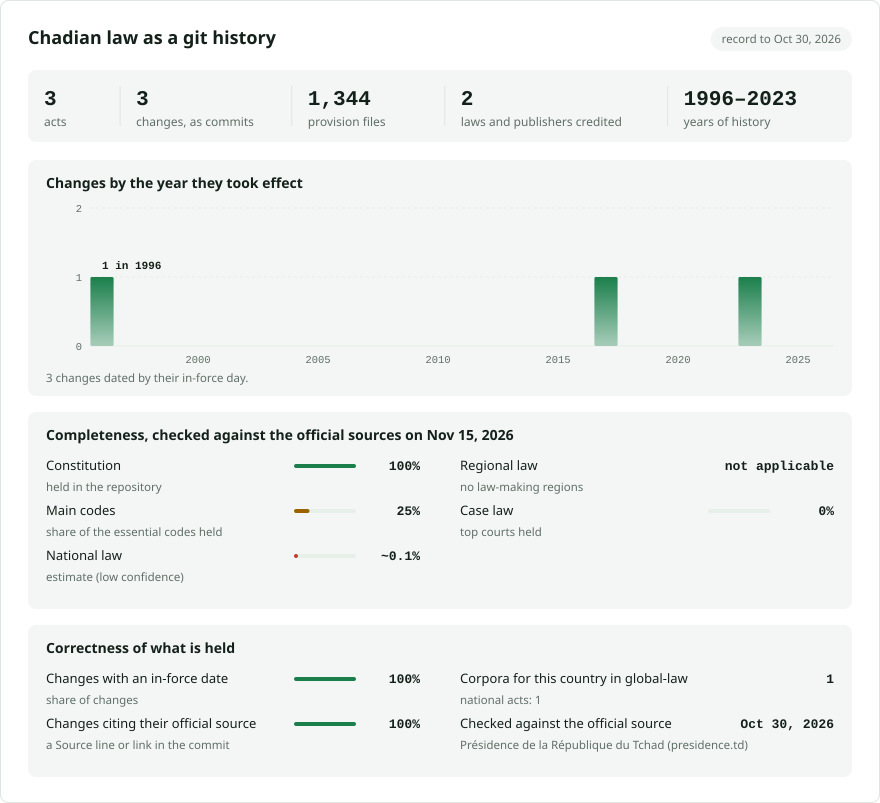

# Chad: law history in git

[Français](README.md) · **English**

<picture>
<source media="(prefers-color-scheme: dark)" srcset="data/effort-dark.svg">

</picture>

The law of Chad as a git history: one file per provision, one commit per version on the day it took effect, and the act that made each change as the commit's author. `git blame` names the act behind every article; `git log` lists every change to an article; picking a date gives the text in force that day.

Part of [lexifina/global-law](https://github.com/lexifina/global-law), one git history for every country's law: this is Chad's national law, which global-law reads at `chad/national/acts/`.

**What is in it now:** 4490 texts, each as its source publishes it: the Constitution of 2023; 7 codes ([code-d-hygiene](codes/code-d-hygiene/), [code-de-l-artisanat](codes/code-de-l-artisanat/), [code-de-l-eau](codes/code-de-l-eau/), [code-de-procedure-penale](codes/code-de-procedure-penale/), [code-du-travail](codes/code-du-travail/), [code-minier](codes/code-minier/), [code-penal](codes/code-penal/)); 772 laws, 491 ordinances, 2499 decrees and 596 orders (arrêtés); 18 decisions, 68 treaties, conventions and agreements, 13 earlier constitutions and fundamental acts, 7 OHADA uniform acts, 3 charters, 6 corrigenda, 9 other acts, filed by kind and year ([STRUCTURE.md](STRUCTURE.md); the full list is [`corpus.json`](corpus.json)). [`REPRODUCE.md`](REPRODUCE.md) lists every decision made by hand; each act's folder has a README giving its source and date. Court decisions are in a separate repository.

Each act is a folder with one file per article: codes in `codes/<code>/`, other texts by kind and year (`lois/1999/…`, `decrets/2010/…`); so `codes/code-du-travail/art-212.md` is Article 212, on paid leave, of the Code du travail, loi n° 038/PR/96 du 11 décembre 1996); the Constitution also has `constitution/preambule.md` and one file per title.

The text is in French, one of Chad's two official languages (Constitution, art. 10), as the sources print it. The Arabic text and an English translation are not part of this record.

## Questions as git commands

| Question | Command |
| --- | --- |
| Every change to Article 212 of the Labour Code | `git log -p --word-diff -- codes/code-du-travail/art-212.md` |
| Which act wrote each line of Article 212? | `git blame codes/code-du-travail/art-212.md` |
| Every version of the Labour Code, with the day each took effect | `git log --format="%h %(trailers:key=In-force,valueonly,separator=) %an" -- 'codes/code-du-travail/art-*.md'` |
| Article 212 as in force on 1 January 2000 | `python tools/on.py 2000-01-01 codes/code-du-travail art-212` |

**Outside git**, we also host this record publicly, for free:

- **[Ask Claude about Chadian law](https://global-law.lexifina.com/v1/try_claude?country=chad)**: opens Claude with a first question ready.
- **[Ask ChatGPT](https://global-law.lexifina.com/v1/try_chatgpt?country=chad)**: the same question in ChatGPT.
- **[Search Chadian law on our site](https://lexifina.com/law?country=chad&q=cong%C3%A9+pay%C3%A9)**: a search for "congé payé", with each provision's text and its versions, no account needed.
- **[Developer REST API](https://global-law.lexifina.com/v1/search_law?query=cong%C3%A9+pay%C3%A9&jurisdiction=chad)**: the same search as JSON, with no key. See the [documentation here](https://lexifina.com/api/global-law).

Both assistants read the record through the free Global law connector (MCP, `https://global-law.lexifina.com/mcp`); the first time, the chat gives you the link that adds it. Ask in French or in English.

**Host it yourself easily.** All it takes is git and Python, and the tools run on your machine:

```sh
git clone --depth 1 https://github.com/lexifina/global-law && cd global-law
python3 tools/countries.py add chad/national/acts
python3 tools/law.py show 2026-01-01 chad/national/acts/codes/code-du-travail/art-212.md
```

Opened in Claude Code, Cursor, VS Code or Codex, the clone also starts a local MCP server with the same tools ([MCP.md](https://github.com/lexifina/global-law/blob/main/MCP.md)).

## Dates

Each commit is dated at noon, Africa/Ndjamena, on the day the version took effect, and carries it in its `In-force:` trailer:

- the Constitution: 29 December 2023, the day it was promulgated, as its art. 283 makes it take effect on promulgation (it was approved by referendum on 17 December 2023);
- the two codes: the date of the law that enacted them (11 December 1996 and 8 May 2017), since each code's last article only orders its publication in the Journal officiel;
- the other texts: the date of the text (promulgation or signature) in its title, or failing that the date of the text in its FAOLEX record; for texts taken from Légitchad, the entry-into-force day that database gives, mostly the signature day (`In-force-basis` trailer); these sources do not give the Journal officiel day; before 1970 the commit is dated 1 January 1970 and the real day is in the subject and in `In-force`.

The other texts are credited to themselves (for example `Loi n° 016/PR/99 du 18 août 1999`).

The Constitution is credited to itself (`Constitution du 29 décembre 2023`). The two codes are each the "oldest version available", credited to the publisher (`Présidence de la République du Tchad (presidence.td)`), and their commit messages say so. The committer is always Lexifina.

## How it is checked

- `tools/check_repo.py` reads every version back from git on the day it took effect and on the day before, and compares it with the corpus the repository was built from: 3 versions, no mismatch.
- A second build from the same corpus into an empty folder gave the same hashes for all 3 law commits and 4 tags.
- No merge commits, no commit date that goes backwards or lies after the build, and every commit's trailers parse; new versions are appended, never rewritten (`tools/append.py`). Results are in [`REPRODUCE.md`](REPRODUCE.md).
- [vulnerabilities/](vulnerabilities/README.en.md): possible drafting mistakes in this law, found by global-law's detectors and checked by hand. Not run yet.

## What it does not show

- **Amendments.** The two codes are held as enacted, with no later amendments applied. The Constitution is held as promulgated, without the technical revision of 2025 (loi constitutionnelle du 3 octobre 2025, promulgated on 8 October 2025), whose text was not found: the Constitution in force may differ from this record.
- **Amendments to the other texts**: each text is given as its source publishes it; amending laws are separate texts and are not applied to the text they amend.
- **Much of Chadian law.** The Journal officiel (journalofficiel.td) is behind a Cloudflare challenge and the Secrétariat général du gouvernement's site (sgg-tchad.org) no longer exists, so the texts come from secondary copies (Légitchad, the CEFOD's legal database, then FAOLEX and WIPO Lex). Texts published only as scans (136 so far) are left out: no OCR is done here; a text layer supplied by the publisher is taken (4 texts, trailer `Text-source: publisher OCR`, not proofread). Also missing: the Code civil (the 1958 French text applied in Chad, with no reliable date); the earlier constitutions that Légitchad gives are in `constitutions-anterieures/`, beside the 2023 text.
- **The Arabic text** of any act.
- **Headings of the codes** (Livre, Titre, Chapitre, Section) are left out; the Code pénal's source has no articles 64, 148, 294 and 359.

## Sources

| Source | Kind | Past versions | Notes |
| --- | --- | --- | --- |
| [Présidence de la République du Tchad](https://presidence.td) | Official publisher: the Constitution | no | The 2023 text as promulgated, from the Présidence's [PDF of June 2024](https://presidence.td/wp-content/uploads/2024/06/Constitution.pdf) |
| FAOLEX (FAO) | Database of national law: the Code pénal | no | The Code as enacted in 2017, from a droit-afrique.com [PDF](https://faolex.fao.org/docs/pdf/cha213367.pdf) |
| [FAOLEX](https://www.fao.org/faolex/) (FAO) | PDF copies of the published texts, with their text layer: the other codes, laws, ordinances, decrees and orders | no | Secondary copy (`Source-status` trailer); non-commercial reuse with credit to FAO |
| [WIPO Lex](https://www.wipo.int/wipolex/) (WIPO) | PDF copies of a few laws | no | Secondary copy (`Source-status` trailer) |
| [Présidence de la République](https://presidence.td) (media library) | Official PDFs of decrees and laws | no | Almost all scans without a text layer: left out |
| [CJAD](https://cjad.nottingham.ac.uk/en/legislation/648/) (University of Nottingham) | Copy of the Ministry of Justice's 2018 edition: the Code de procédure pénale of 2017 | no | Secondary copy (`Source-status` trailer), born-digital PDF; in force 1 October 2017 (art. 691) |
| [Légitchad](https://legitchad.org) (Banque tchadienne de données juridiques, CEFOD) | Texts in HTML: laws, ordinances, decrees, orders, decisions, treaties and agreements, earlier constitutions | no | Secondary copy (`Source-status` trailer); official text only (the database's keywords and notes left out); dated on the entry-into-force day the database gives, mostly the signature day; individual measures (appointments, decorations, pardons, session openings) left out |
| NATLEX (ILO) | Database of national labour law: the Code du travail | no | The 1996 text, read from an [Internet Archive copy](https://web.archive.org/web/20171002/https://www.ilo.org/dyn/natlex/docs/WEBTEXT/47297/65070/F96TCD01.htm) of 2 October 2017 |

## Licence

See [`LICENSE`](LICENSE). The texts are reproduced with attribution to their sources; Chad is a member of OAPI, and the Bangui Agreement (Annex VII, art. 6(i)) excludes official texts of a legislative nature from copyright protection. Lexifina's own contributions (the history, the commit messages, the tables and the tools) are CC0 1.0.

No AI model wrote, translated or corrected legal text, and none runs when the history is built; the scripts were written by an AI model (see [`REPRODUCE.md`](REPRODUCE.md)).

## Visualisations

- [visualisations/](visualisations/README.en.md): charts drawn from this repository. Not drawn yet.

## More

From [lexifina/global-law](https://github.com/lexifina/global-law):

- [FEATURES.md](https://github.com/lexifina/global-law/blob/main/FEATURES.md): every feature, and what every corpus must support (`git blame`, `law.py`, the MCP tools)
- [FAQ.md](https://github.com/lexifina/global-law/blob/main/FAQ.md): questions and answers · [CONTRIBUTING.md](https://github.com/lexifina/global-law/blob/main/CONTRIBUTING.md): proposing changes · [MCP.md](https://github.com/lexifina/global-law/blob/main/MCP.md): the MCP server · [REPRODUCE.md](https://github.com/lexifina/global-law/blob/main/REPRODUCE.md): how it was built · [CHANGELOG.md](https://github.com/lexifina/global-law/blob/main/CHANGELOG.md)
- [FRESHNESS.md](https://github.com/lexifina/global-law/blob/main/FRESHNESS.md): how current each corpus is · [Monitoring](https://github.com/lexifina/global-law/tree/main/monitoring): whether updates are running · [WATCHING.md](https://github.com/lexifina/global-law/blob/main/WATCHING.md): how each official source is watched for changes
- [performance/](https://github.com/lexifina/global-law/tree/main/performance): how fast the tools are, measured
- [visualisations/](https://github.com/lexifina/global-law/tree/main/visualisations): charts and bridges across the world's law
- [Vulnerabilities](https://github.com/lexifina/global-law/tree/main/vulnerabilities): mistakes in legislation as published
