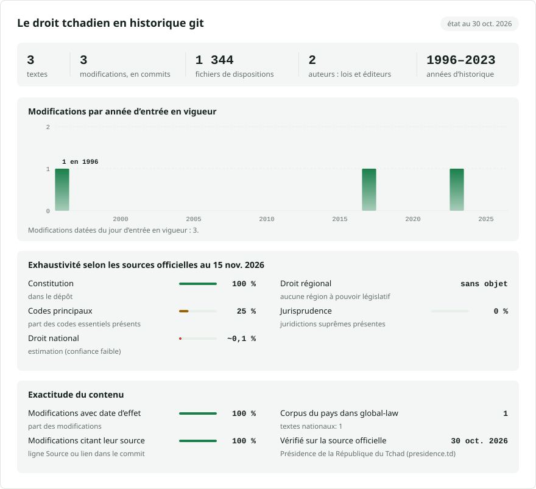

# Tchad : l’historique du droit dans git

**Français** · [English](README.en.md)

<picture>
<source media="(prefers-color-scheme: dark)" srcset="data/fr/effort-dark.svg">

</picture>

Le droit tchadien sous forme d’historique git : un fichier par disposition, un commit par version au jour de son entrée en vigueur, et pour auteur de chaque commit le texte qui a apporté la modification. `git blame` désigne le texte à l’origine de chaque article ; `git log` énumère toutes les modifications d’un article ; le choix d’une date donne le texte en vigueur ce jour-là.

Fait partie de [lexifina/global-law](https://github.com/lexifina/global-law), un historique git unique pour le droit de chaque pays : ce dépôt contient le droit national tchadien, que global-law lit dans `chad/national/acts/`.

**Contenu actuel :** 120 textes, chacun dans la version que publie sa source : la Constitution de 2023 ; 7 codes ([code-d-hygiene](codes/code-d-hygiene/), [code-de-l-artisanat](codes/code-de-l-artisanat/), [code-de-l-eau](codes/code-de-l-eau/), [code-de-procedure-penale](codes/code-de-procedure-penale/), [code-du-travail](codes/code-du-travail/), [code-minier](codes/code-minier/), [code-penal](codes/code-penal/)) ; 21 lois, 4 ordonnances, 50 décrets et 37 arrêtés, rangés par nature et par année ([STRUCTURE.md](STRUCTURE.md), liste complète dans [`corpus.json`](corpus.json)). [`REPRODUCE.md`](REPRODUCE.md) énumère les décisions prises manuellement ; le dossier de chaque texte contient un README qui donne sa source et sa date. Les décisions de justice (OHADA) sont dans un dépôt séparé.

Chaque texte est un dossier comportant un fichier par article : les codes dans `codes/<code>/`, les autres textes par nature et par année (`lois/1999/…`, `decrets/2010/…`) ; ainsi `codes/code-du-travail/art-212.md` est l’article 212, relatif aux congés payés, du Code du travail, loi n° 038/PR/96 du 11 décembre 1996) ; la Constitution comporte en outre `constitution/preambule.md` et un fichier par titre.

Le texte est en français, l’une des deux langues officielles du Tchad (Constitution, art. 10), tel que l’impriment les sources. Le texte arabe et une traduction anglaise ne font pas partie de ce registre.

## Questions sous forme de commandes git

| Question | Commande |
| --- | --- |
| Toutes les modifications de l’article 212 du Code du travail | `git log -p --word-diff -- codes/code-du-travail/art-212.md` |
| Quel texte a écrit chaque ligne de l’article 212 ? | `git blame codes/code-du-travail/art-212.md` |
| Toutes les versions du Code du travail, avec le jour d’entrée en vigueur de chacune | `git log --format="%h %(trailers:key=In-force,valueonly,separator=) %an" -- 'codes/code-du-travail/art-*.md'` |
| L’article 212 tel qu’en vigueur le 1er janvier 2000 | `python tools/on.py 2000-01-01 codes/code-du-travail art-212` |

**En dehors de git**, nous hébergeons aussi ce registre publiquement, gratuitement :

- **[Interroger Claude sur le droit tchadien](https://global-law.lexifina.com/v1/try_claude?country=chad)** : ouvre Claude avec une première question prête.
- **[Interroger ChatGPT](https://global-law.lexifina.com/v1/try_chatgpt?country=chad)** : la même question dans ChatGPT.
- **[Rechercher dans le droit tchadien sur notre site](https://lexifina.com/law?country=chad&q=cong%C3%A9+pay%C3%A9)** : une recherche de « congé payé », avec le texte de chaque disposition et ses versions, sans compte.
- **[API REST pour les développeurs](https://global-law.lexifina.com/v1/search_law?query=cong%C3%A9+pay%C3%A9&jurisdiction=chad)** : la même recherche en JSON, sans clé. Voir la [documentation ici](https://lexifina.com/api/global-law).

Les deux assistants lisent le registre au moyen du connecteur gratuit Global law (MCP, `https://global-law.lexifina.com/mcp`) ; la première fois, la conversation vous donne le lien qui l’ajoute. Posez vos questions en français ou en anglais.

**L’héberger vous-même, simplement.** Il suffit de git et de Python, et les outils s’exécutent sur votre machine :

```sh
git clone --depth 1 https://github.com/lexifina/global-law && cd global-law
python3 tools/countries.py add chad/national/acts
python3 tools/law.py show 2026-01-01 chad/national/acts/codes/code-du-travail/art-212.md
```

Ouvert dans Claude Code, Cursor, VS Code ou Codex, le clone lance aussi un serveur MCP local doté des mêmes outils ([MCP.md](https://github.com/lexifina/global-law/blob/main/MCP.md)).

## Dates

Chaque commit est daté à midi, heure de N’Djamena (Africa/Ndjamena), du jour où la version est entrée en vigueur, et porte ce jour dans son trailer `In-force:` :

- la Constitution : le 29 décembre 2023, jour de sa promulgation, son article 283 la faisant entrer en vigueur dès sa promulgation (elle a été approuvée par référendum le 17 décembre 2023) ;
- les deux codes : la date de la loi qui les a adoptés (le 11 décembre 1996 et le 8 mai 2017), le dernier article de chaque code se bornant à en ordonner la publication au Journal officiel ;
- les autres textes : la date du texte (promulgation ou signature) que donne son intitulé, ou à défaut la date du texte qu’indique la fiche FAOLEX (trailer `In-force-basis`) ; le jour de publication au Journal officiel n’est pas donné par ces sources ; avant 1970, le commit est daté du 1er janvier 1970 et le vrai jour figure dans l’objet et dans `In-force`.

Les autres textes sont attribués à eux-mêmes (par exemple `Loi n° 016/PR/99 du 18 août 1999`).

La Constitution est attribuée à elle-même (`Constitution du 29 décembre 2023`). Les deux codes constituent chacun la « plus ancienne version disponible », attribuée à l’éditeur (`Présidence de la République du Tchad (presidence.td)`), ce que précisent leurs messages de commit. Le committer est toujours Lexifina.

## Comment il est vérifié

- `tools/check_repo.py` relit chaque version depuis git au jour de son entrée en vigueur et la veille, et la compare au corpus à partir duquel le dépôt a été construit : 3 versions, aucune divergence.
- Une seconde construction à partir du même corpus dans un dossier vide a donné les mêmes empreintes pour les 3 commits de textes et les 4 tags.
- Aucun commit de fusion, aucune date de commit qui recule ou qui soit postérieure à la construction, et les trailers de chaque commit se lisent sans erreur ; les nouvelles versions sont ajoutées, jamais réécrites (`tools/append.py`). Les résultats figurent dans [`REPRODUCE.md`](REPRODUCE.md).
- [vulnerabilities/](vulnerabilities/): erreurs de rédaction possibles dans ce droit, trouvées par les détecteurs de global-law et vérifiées à la main. Pas encore lancé.

## Ce qu’il ne montre pas

- **Les modifications.** Les deux codes figurent tels qu’adoptés, sans application d’aucune modification ultérieure. La Constitution figure telle que promulguée, sans la révision technique de 2025 (loi constitutionnelle du 3 octobre 2025, promulguée le 8 octobre 2025), dont le texte n’a pas été trouvé : la Constitution en vigueur peut différer de ce registre.
- **Les modifications des autres textes** : chaque texte est donné dans la version publiée par sa source ; les lois modificatives sont des textes distincts et ne sont pas appliquées au texte modifié.
- **Une grande partie du droit tchadien.** Le Journal officiel (journalofficiel.td) est protégé par un contrôle Cloudflare, et le site du Secrétariat général du gouvernement (sgg-tchad.org) n’existe plus ; les textes viennent donc surtout de copies secondaires (FAOLEX, WIPO Lex). Les textes publiés seulement en numérisation (136 à ce jour) sont écartés : aucune OCR n’est faite ici ; une couche texte fournie par l’éditeur est reprise (4 textes, trailer `Text-source: publisher OCR`, non relue). Manquent aussi le Code civil (version de 1958 applicable au Tchad, sans date sûre) et les constitutions antérieures (1996, 2018).
- **Le texte arabe** des textes.
- **Les intitulés des codes** (Livre, Titre, Chapitre, Section) sont omis ; la source du Code pénal ne comporte pas d’articles 64, 148, 294 et 359.

## Sources

| Source | Nature | Versions antérieures | Remarques |
| --- | --- | --- | --- |
| [Présidence de la République du Tchad](https://presidence.td) | Éditeur officiel : la Constitution | non | Le texte de 2023 tel que promulgué, d’après le [PDF de juin 2024](https://presidence.td/wp-content/uploads/2024/06/Constitution.pdf) de la Présidence |
| FAOLEX (FAO) | Base de données du droit national : le Code pénal | non | Le Code tel qu’adopté en 2017, d’après un [PDF](https://faolex.fao.org/docs/pdf/cha213367.pdf) de droit-afrique.com |
| [FAOLEX](https://www.fao.org/faolex/) (FAO) | Copies PDF des textes publiés, avec leur couche texte : les autres codes, lois, ordonnances, décrets et arrêtés | non | Copie secondaire (trailer `Source-status`) ; réutilisation non commerciale avec mention de la FAO |
| [WIPO Lex](https://www.wipo.int/wipolex/) (OMPI) | Copies PDF de quelques lois | non | Copie secondaire (trailer `Source-status`) |
| [Présidence de la République](https://presidence.td) (médiathèque) | PDF officiels de décrets et de lois | non | Presque tous numérisés sans couche texte : écartés |
| [CJAD](https://cjad.nottingham.ac.uk/en/legislation/648/) (Université de Nottingham) | Copie de l’édition 2018 du Ministère de la Justice : le Code de procédure pénale de 2017 | non | Copie secondaire (trailer `Source-status`), PDF natif ; en vigueur le 1er octobre 2017 (art. 691) |
| [FAOLEX](https://www.fao.org/faolex/) (FAO) | Copies PDF des textes publiés, avec leur couche texte : les autres codes, lois, ordonnances, décrets et arrêtés | non | Copie secondaire (trailer `Source-status`) ; réutilisation non commerciale avec mention de la FAO |
| [WIPO Lex](https://www.wipo.int/wipolex/) (OMPI) | Copies PDF de quelques lois | non | Copie secondaire (trailer `Source-status`) |
| [Présidence de la République](https://presidence.td) (médiathèque) | PDF officiels de décrets et de lois | non | Presque tous numérisés sans couche texte : écartés |
| [CJAD](https://cjad.nottingham.ac.uk/en/legislation/648/) (Université de Nottingham) | Copie de l’édition 2018 du Ministère de la Justice : le Code de procédure pénale de 2017 | non | Copie secondaire (trailer `Source-status`), PDF natif ; en vigueur le 1er octobre 2017 (art. 691) |
| NATLEX (OIT) | Base de données du droit national du travail : le Code du travail | non | Le texte de 1996, lu dans une [copie de l’Internet Archive](https://web.archive.org/web/20171002/https://www.ilo.org/dyn/natlex/docs/WEBTEXT/47297/65070/F96TCD01.htm) du 2 octobre 2017 |

## Licence

Voir [`LICENSE`](LICENSE). Les textes sont reproduits avec mention de leurs sources ; le Tchad est membre de l’OAPI, et l’Accord de Bangui (annexe VII, art. 6.i)) exclut de la protection par le droit d’auteur les textes officiels de nature législative. Les contributions propres de Lexifina (l’historique, les messages de commit, les tableaux et les outils) sont sous CC0 1.0.

Aucun modèle d’IA n’a écrit, traduit ou corrigé de texte juridique, et aucun n’est exécuté lors de la construction de l’historique ; les scripts ont été écrits par un modèle d’IA (voir [`REPRODUCE.md`](REPRODUCE.md)).

Ceci est une traduction de la version anglaise ([README.en.md](README.en.md)) ; en cas de divergence, la version anglaise fait foi.

## Visualisations

- [visualisations/](visualisations/): graphiques tirés de ce dépôt. Pas encore dessinés.

## En savoir plus

Dans le dépôt [lexifina/global-law](https://github.com/lexifina/global-law) (pages en anglais) :

- [FEATURES.md](https://github.com/lexifina/global-law/blob/main/FEATURES.md): toutes les fonctionnalités et ce que chaque corpus doit prendre en charge (`git blame`, `law.py`, outils MCP)
- [FAQ.md](https://github.com/lexifina/global-law/blob/main/FAQ.md): questions et réponses · [CONTRIBUTING.md](https://github.com/lexifina/global-law/blob/main/CONTRIBUTING.md): proposer une modification · [MCP.md](https://github.com/lexifina/global-law/blob/main/MCP.md): serveur MCP · [REPRODUCE.md](https://github.com/lexifina/global-law/blob/main/REPRODUCE.md): comment il a été construit · [CHANGELOG.md](https://github.com/lexifina/global-law/blob/main/CHANGELOG.md)
- [FRESHNESS.md](https://github.com/lexifina/global-law/blob/main/FRESHNESS.md): à quel point chaque corpus est à jour · [Surveillance](https://github.com/lexifina/global-law/tree/main/monitoring): si les mises à jour fonctionnent · [WATCHING.md](https://github.com/lexifina/global-law/blob/main/WATCHING.md): comment chaque source officielle est surveillée pour repérer les modifications
- [performance/](https://github.com/lexifina/global-law/tree/main/performance): la rapidité des outils, mesurée
- [visualisations/](https://github.com/lexifina/global-law/tree/main/visualisations): graphiques et liens à travers le droit du monde entier
- [Vulnérabilités](https://github.com/lexifina/global-law/tree/main/vulnerabilities): erreurs dans les textes tels qu’ils ont été publiés
